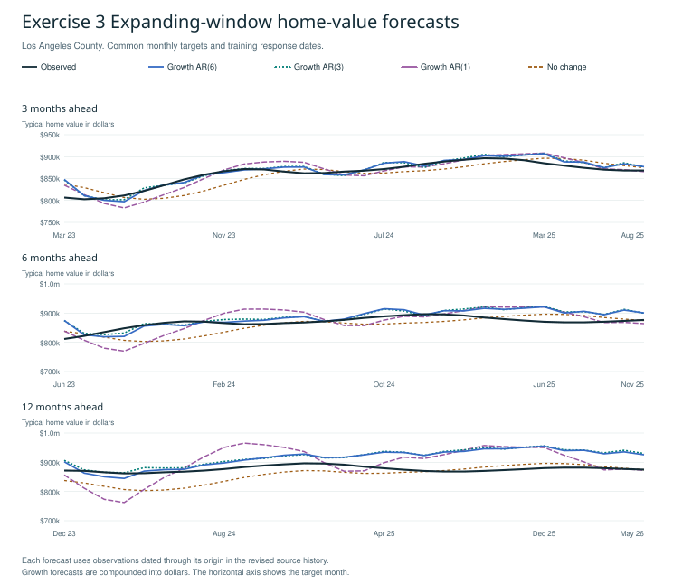
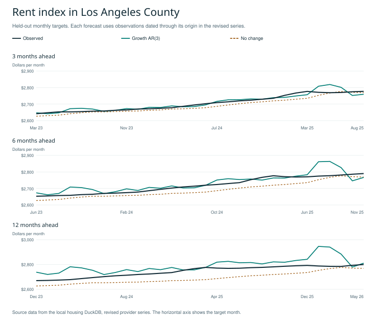
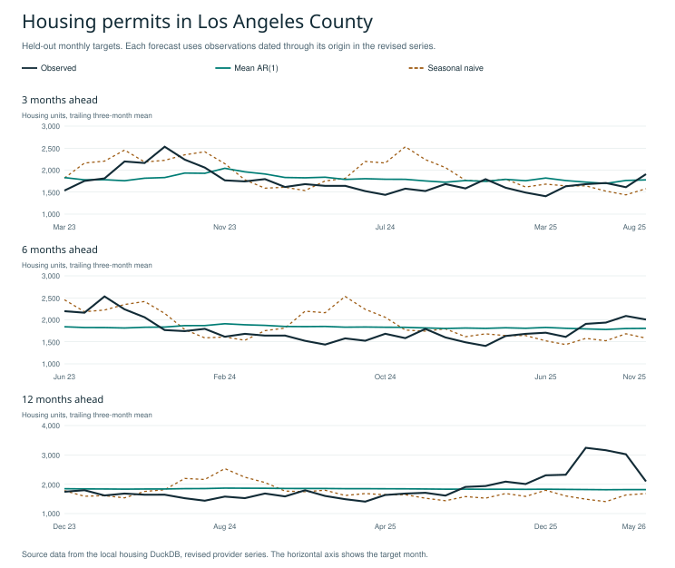
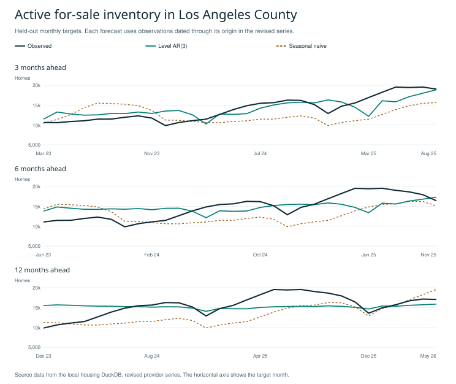

# Week 1 housing forecasting exercise answers

This submission follows all seven numbered exercises in the supplied teaching module. Each exercise includes the requested model, numerical results and interpretation. The three final interpretation questions are answered after Exercise 7. All numbers come from the local housing database and the reproducible Week 1 run.

## Data and evaluation dates

The primary raw training window begins in 2015-01. We use 13 monthly validation origins from 2020-12 through 2021-12 and 30 later test origins from 2022-12 through 2025-05. Validation outcomes through the longest horizon are available by the first test origin. The 3-, 6- and 12-month targets are identical across candidate models and eligible counties. Tables below report test errors unless labeled validation.

| Geography | Variable | Observed first month | Observed last month | Missing months | Study status |
| --- | --- | --- | --- | --- | --- |
| Los Angeles County | zhvi | 2000-01 | 2026-08 | 0 | evaluated |
| Orange County | zhvi | 2000-01 | 2026-08 | 0 | evaluated |
| Riverside County | zhvi | 2000-01 | 2026-08 | 0 | evaluated |
| San Diego County | zhvi | 2000-01 | 2026-08 | 0 | evaluated |
| California | zhvi | Unavailable | Unavailable | N/A | insufficient coverage for fixed calendar |
| Los Angeles County | zori_smoothed_sa | 2015-01 | 2026-08 | 0 | evaluated |
| Los Angeles County | active_inventory | 2012-01 | 2026-05 | 0 | evaluated |
| Los Angeles County | permits_total | 2000-01 | 2026-06 | 0 | evaluated |

We forecast log growth and recover price/rent levels by compounding the predicted changes. Consequently, MAE and RMSE in the price and rent tables are in USD and USD per month, respectively. They measure errors in recovered levels. MAPE compares errors relative to each observed level. These retrospective backtests use revised, provider-smoothed histories. Publication dates and historical release vintages have not been reconstructed.

The introductory level AR(1) estimates P_t = a + b P_(t−1) + e_t; a trending or nonstationary price level can give a high fitted R squared without good forecasts. The growth AR(1) instead models g_t = a + b g_(t−1) + e_t. Recover a horizon-h level as P_hat_(t+h) = P_t × exp[(g_hat_(t+1) + … + g_hat_(t+h)) / 100]. Lag length counts past predictors; horizon counts months ahead. For example, AR(3) can produce a 12-month forecast by recursion. More lags can capture dynamics but estimate more parameters from the available sample. These introductory models and comparisons are included below.

## Exercise 1  Lag length comparison

**1.1 Estimate AR(1), AR(3), and AR(6) for monthly LA County ZHVI log growth using a consistent sample.**

Let P_t be LA County ZHVI and g_t = 100 × [ln(P_t) − ln(P_(t−1))]. For AR(p), the LHS is g_t and the RHS contains an intercept and each separate lag g_(t−1), …, g_(t−p), for p equal to 1, 3 and 6. All three models retain six growth observations for initialization so that their fitted response months coincide.

**1.2 Record the LHS, every RHS lag, coefficients, number of observations, and training dates.**

The following regression snapshot uses information through 2022-12, the first test origin. Training RMSE is in percentage points of monthly log growth. The coefficients table includes every estimated RHS term. The complete origin-by-origin fits are in [regressions.csv](regressions.csv).

| Model | Raw start | First fitted month | Last fitted month | N | Training RMSE | R squared |
| --- | --- | --- | --- | --- | --- | --- |
| Growth AR(1) | 2015-01 | 2015-08 | 2022-12 | 89 | 0.4749 | 0.7412 |
| Growth AR(3) | 2015-01 | 2015-08 | 2022-12 | 89 | 0.3098 | 0.8899 |
| Growth AR(6) | 2015-01 | 2015-08 | 2022-12 | 89 | 0.2995 | 0.8971 |

| Model | Raw start | Term | Coefficient |
| --- | --- | --- | --- |
| Growth AR(1) | 2015-01 | intercept | 0.080553 |
| Growth AR(1) | 2015-01 | log_growth_pct_lag_1 | 0.864224 |
| Growth AR(3) | 2015-01 | intercept | 0.161995 |
| Growth AR(3) | 2015-01 | log_growth_pct_lag_1 | 1.486184 |
| Growth AR(3) | 2015-01 | log_growth_pct_lag_2 | -0.705458 |
| Growth AR(3) | 2015-01 | log_growth_pct_lag_3 | -0.036958 |
| Growth AR(6) | 2015-01 | intercept | 0.145308 |
| Growth AR(6) | 2015-01 | log_growth_pct_lag_1 | 1.507184 |
| Growth AR(6) | 2015-01 | log_growth_pct_lag_2 | -0.765025 |
| Growth AR(6) | 2015-01 | log_growth_pct_lag_3 | -0.039902 |
| Growth AR(6) | 2015-01 | log_growth_pct_lag_4 | 0.287202 |
| Growth AR(6) | 2015-01 | log_growth_pct_lag_5 | -0.446009 |
| Growth AR(6) | 2015-01 | log_growth_pct_lag_6 | 0.226295 |

**1.3 Forecast the same later observations and compare 3-, 6-, and 12-month accuracy.**

Recovered home-value accuracy is measured in dollars on the same test dates.

| Specification | 3m MAE | 3m RMSE | 6m MAE | 6m RMSE | 12m MAE | 12m RMSE |
| --- | --- | --- | --- | --- | --- | --- |
| Growth AR(1) | 12,228.86 | 14,938.09 | 29,022.62 | 35,224.48 | 46,040.24 | 54,855.57 |
| Growth AR(3) | 8,688.48 | 11,761.14 | 20,828.75 | 25,910.80 | 41,226.46 | 47,851.26 |
| Growth AR(6) | 8,270.45 | 11,589.69 | 20,149.91 | 25,467.32 | 40,337.34 | 46,322.93 |

**1.4a Which model fits training data best?**

Growth AR(6) has the lowest training RMSE in this common-sample snapshot. The three rows above use identical fitted response months, so their training errors are comparable.

**1.4b Does it forecast best?**

Among these three growth models, the lowest test RMSE comes from Growth AR(6) at all three horizons. The best-fitting model therefore also forecasts best in this comparison. This is a comparison using realized test outcomes. Exercise 3 separately evaluates the specifications that earlier validation data selected.

**1.4c Does this change by horizon?**

The winning lag length stays the same at all three horizons. The benchmark comparison can still change with horizon. The following table states directly whether the best growth AR beats no change at each horizon.

| Horizon | Best growth AR | Growth AR RMSE | No-change RMSE | Growth AR beats no change |
| --- | --- | --- | --- | --- |
| 3 | Growth AR(6) | 11,590 | 18,241 | Yes |
| 6 | Growth AR(6) | 25,467 | 27,766 | Yes |
| 12 | Growth AR(6) | 46,323 | 31,587 | No |

## Exercise 2  Window sensitivity

**2.1 Keep AR(3), the outcome, and evaluation dates unchanged. Change only the training start.**

Hold the LHS, AR(3) lag terms, expanding-window ends and all target dates fixed. Change only the first raw observation to each of the three dates below. The same seven-month growth/lag initialization applies to every start.

**2.2 How do the fitted coefficients and forecast errors compare across samples?**

| Model | Raw start | First fitted month | Last fitted month | N | Training RMSE | R squared |
| --- | --- | --- | --- | --- | --- | --- |
| Growth AR(3) | 2010-01 | 2010-08 | 2022-12 | 149 | 0.3079 | 0.8942 |
| Growth AR(3) | 2015-01 | 2015-08 | 2022-12 | 89 | 0.3098 | 0.8899 |
| Growth AR(3) | 2019-01 | 2019-08 | 2022-12 | 41 | 0.2322 | 0.8998 |

| Model | Raw start | Term | Coefficient |
| --- | --- | --- | --- |
| Growth AR(3) | 2010-01 | intercept | 0.101827 |
| Growth AR(3) | 2010-01 | log_growth_pct_lag_1 | 1.498180 |
| Growth AR(3) | 2010-01 | log_growth_pct_lag_2 | -0.672246 |
| Growth AR(3) | 2010-01 | log_growth_pct_lag_3 | -0.016983 |
| Growth AR(3) | 2015-01 | intercept | 0.161995 |
| Growth AR(3) | 2015-01 | log_growth_pct_lag_1 | 1.486184 |
| Growth AR(3) | 2015-01 | log_growth_pct_lag_2 | -0.705458 |
| Growth AR(3) | 2015-01 | log_growth_pct_lag_3 | -0.036958 |
| Growth AR(3) | 2019-01 | intercept | 0.144346 |
| Growth AR(3) | 2019-01 | log_growth_pct_lag_1 | 1.609759 |
| Growth AR(3) | 2019-01 | log_growth_pct_lag_2 | -0.900912 |
| Growth AR(3) | 2019-01 | log_growth_pct_lag_3 | 0.092455 |

| Specification | 3m MAE | 3m RMSE | 6m MAE | 6m RMSE | 12m MAE | 12m RMSE |
| --- | --- | --- | --- | --- | --- | --- |
| Start 2010-01 | 8,266.22 | 10,897.42 | 20,033.29 | 23,468.57 | 35,898.57 | 41,868.88 |
| Start 2015-01 | 8,688.48 | 11,761.14 | 20,828.75 | 25,910.80 | 41,226.46 | 47,851.26 |
| Start 2019-01 | 9,259.44 | 12,104.06 | 23,958.41 | 27,720.22 | 44,483.04 | 48,775.77 |

Six-month RMSE is $23,469, $25,911, $27,720 as the training start moves through the dates shown. The first-lag coefficients are 1.498, 1.486, 1.610, and the second-lag coefficients are -0.672, -0.705, -0.901. The recent window gives a stronger immediate response and a larger subsequent reversal in this run. Its smaller training error does not translate into the smallest test error.

**2.3 Why can periods covering COVID-era dynamics or mortgage-rate changes produce different coefficients?**

The latest window starts in 2019-01 and has only 17 fitted responses at the first validation origin. Pandemic-era changes in demand, available supply and prices therefore receive greater weight. Mortgage rates affect borrowing costs and purchasing power, which can change how price growth persists or reverses. An AR model summarizes those relationships through its lag coefficients. Changing the period changes the mixture of market conditions being summarized. These univariate regressions do not identify the separate causal effect of COVID or mortgage rates.

**2.4 What is the difference between an expanding and a rolling window?**

An expanding window fixes the start and advances the end. A rolling window advances both boundaries to retain a fixed length.

## Exercise 3  Expanding window backtest

**3.1 Select an initial training period of at least five years.**

The initial raw window is 2015-01 through 2020-12, 72 consecutive monthly levels. It exceeds five years and has no missing months. The log difference and common lag initialization reduce the number of fitted responses, as recorded in the regression table.

**3.2 Estimate AR(1) and forecast 3, 6, and 12 months ahead.**

At the initial 2020-12 origin, retain the monthly levels from 2015-01 through that origin. Construct only backward differences and lags. Estimate each AR model, predict the next month, then feed predicted growth into subsequent unavailable lags. Compound each path from the observed origin level and retain the 3-, 6- and 12-month predictions. For a concrete example, the first test origin gives the following AR(1) forecasts in dollars.

| Origin | Horizon | Target month | Forecast | Actual | Forecast minus actual |
| --- | --- | --- | --- | --- | --- |
| 2022-12 | 3 | 2023-03 | 835,059 | 806,698 | 28,361 |
| 2022-12 | 6 | 2023-06 | 838,665 | 811,396 | 27,269 |
| 2022-12 | 12 | 2023-12 | 856,695 | 871,662 | -14,967 |

**3.3 Advance the origin by one month, re-estimate, and repeat until the test period ends.**

The test loop starts at 2022-12, advances one calendar month at a time and ends at 2025-05. It produces 30 forecasts for each model and horizon. Each new fit uses the expanded history through its own origin.

**3.4 Apply the same procedure to AR(3), AR(6), and a naive benchmark.**

AR(3) and AR(6) use the same response months and forecast origins as AR(1). The no-change benchmark predicts the last observed home value at every horizon. All four are scored on identical observed targets.

**3.5 Plot predicted versus actual home values and calculate MAE and RMSE separately by horizon.**

For each horizon, error = forecast − actual, MAE = mean absolute error, and RMSE = square root of mean squared error. The same procedure covers AR(1/3/6) and no change. The table below contains the requested horizon-specific scores, plus the introductory benchmarks.

| Specification | 3m MAE | 3m RMSE | 6m MAE | 6m RMSE | 12m MAE | 12m RMSE |
| --- | --- | --- | --- | --- | --- | --- |
| Growth AR(1) | 12,228.86 | 14,938.09 | 29,022.62 | 35,224.48 | 46,040.24 | 54,855.57 |
| Growth AR(3) | 8,688.48 | 11,761.14 | 20,828.75 | 25,910.80 | 41,226.46 | 47,851.26 |
| Growth AR(6) | 8,270.45 | 11,589.69 | 20,149.91 | 25,467.32 | 40,337.34 | 46,322.93 |
| No change | 15,192.22 | 18,240.87 | 21,830.33 | 27,766.25 | 25,687.90 | 31,586.51 |
| Seasonal naive | 30,206.78 | 34,589.33 | 28,500.14 | 33,290.32 | 25,687.90 | 31,586.51 |
| Level AR(1) | 16,359.78 | 20,146.64 | 25,371.51 | 30,159.69 | 34,671.27 | 39,236.12 |
| ARIMA(0,1,1) | 13,375.20 | 15,832.61 | 21,084.70 | 26,773.47 | 25,505.82 | 31,379.58 |

The level AR(1) directly regresses P_t on an intercept and P_(t−1). The introductory ARIMA(0,1,1) uses log prices, no drift, and a moving-average term in the differenced series. The seasonal benchmark repeats the corresponding month one year earlier.

The benchmark fit snapshot below also uses the 2022-12 origin. Level AR(1) training RMSE is in dollars. ARIMA innovation RMSE is in percentage points of monthly log growth, and OLS R squared does not apply to that conditional innovation fit.

| Model | Raw start | First fitted month | Last fitted month | N | Training RMSE | R squared |
| --- | --- | --- | --- | --- | --- | --- |
| Level AR(1) | 2015-01 | 2015-04 | 2022-12 | 93 | 5587.3974 | 0.9977 |
| ARIMA(0,1,1) | 2015-01 | 2015-02 | 2022-12 | 95 | 0.6224 | N/A |

| Model | Raw start | Term | Coefficient |
| --- | --- | --- | --- |
| Level AR(1) | 2015-01 | intercept | -1299.260338 |
| Level AR(1) | 2015-01 | level_lag_1 | 1.008247 |
| ARIMA(0,1,1) | 2015-01 | innovation_lag_1 | 0.889753 |

**3.6 Keep an early validation period for choosing specifications and reserve a later independent test period.**

Validation origins run from 2020-12 through 2021-12. Test origins run from 2022-12 through 2025-05. For independent evaluation, choose a model and training start using the minimum validation RMSE for that horizon, then assess that choice on the later test origins.

| Horizon | Validation choice | Start | Validation RMSE | Test MAE | Test RMSE | No-change test RMSE |
| --- | --- | --- | --- | --- | --- | --- |
| 3 | Level AR(1) | 2015-01 | 7,819 | 16,360 | 20,147 | 18,241 |
| 6 | Level AR(1) | 2015-01 | 13,308 | 25,372 | 30,160 | 27,766 |
| 12 | Growth AR(1) | 2015-01 | 31,351 | 46,040 | 54,856 | 31,587 |

The validation-selected specifications have equal or larger test RMSE than no change at all three horizons. Good fitted values and even good validation performance do not guarantee performance in a later market period. All comparisons use matching dates, and adjacent multi-month errors overlap.

**3.7 How is leakage avoided, and what limitation remains?**

At each origin, slice the observed history before creating differences or lags and estimating coefficients. Recursion uses predicted future growth whenever a lag extends beyond the origin. Actual future values enter only the subsequent error calculation. No full-sample standardization or additional smoothing is applied. Provider revisions and smoothing are already embedded in the published histories, so these results are explicitly retrospective rather than real-time reconstructions of past information sets.

## Exercise 4  Rent growth forecasts

**4.1 Estimate AR(1) for rent growth and state the LHS and RHS.**

Use the active all-homes-plus-multifamily ZORI, which Zillow smooths and seasonally adjusts. Let r_t = 100 × [ln(R_t) − ln(R_(t−1))]. The LHS is r_t and the RHS is an intercept plus r_(t−1). Recover forecast rent levels by compounding predicted growth from the origin rent.

**4.2 Repeat with three and six lags.**

AR(3) adds r_(t−2) and r_(t−3); AR(6) additionally includes r_(t−4), r_(t−5), and r_(t−6), each with its own coefficient. All three fits use the same response months. The next tables give the fitted equations and test MAE/RMSE in dollars per month.

| Model | Raw start | First fitted month | Last fitted month | N | Training RMSE | R squared |
| --- | --- | --- | --- | --- | --- | --- |
| Growth AR(1) | 2015-01 | 2015-08 | 2022-12 | 89 | 0.1529 | 0.7909 |
| Growth AR(3) | 2015-01 | 2015-08 | 2022-12 | 89 | 0.1414 | 0.8213 |
| Growth AR(6) | 2015-01 | 2015-08 | 2022-12 | 89 | 0.1340 | 0.8394 |

| Model | Raw start | Term | Coefficient |
| --- | --- | --- | --- |
| Growth AR(1) | 2015-01 | intercept | 0.044194 |
| Growth AR(1) | 2015-01 | log_growth_pct_lag_1 | 0.891254 |
| Growth AR(3) | 2015-01 | intercept | 0.057681 |
| Growth AR(3) | 2015-01 | log_growth_pct_lag_1 | 0.837147 |
| Growth AR(3) | 2015-01 | log_growth_pct_lag_2 | 0.398861 |
| Growth AR(3) | 2015-01 | log_growth_pct_lag_3 | -0.371603 |
| Growth AR(6) | 2015-01 | intercept | 0.059472 |
| Growth AR(6) | 2015-01 | log_growth_pct_lag_1 | 0.915880 |
| Growth AR(6) | 2015-01 | log_growth_pct_lag_2 | 0.339349 |
| Growth AR(6) | 2015-01 | log_growth_pct_lag_3 | -0.652550 |
| Growth AR(6) | 2015-01 | log_growth_pct_lag_4 | 0.347820 |
| Growth AR(6) | 2015-01 | log_growth_pct_lag_5 | 0.133767 |
| Growth AR(6) | 2015-01 | log_growth_pct_lag_6 | -0.223141 |

| Specification | 3m MAE | 3m RMSE | 6m MAE | 6m RMSE | 12m MAE | 12m RMSE |
| --- | --- | --- | --- | --- | --- | --- |
| Growth AR(1) | 10.60 | 14.46 | 18.28 | 25.77 | 39.09 | 52.74 |
| Growth AR(3) | 12.39 | 16.61 | 22.58 | 31.16 | 49.43 | 62.26 |
| Growth AR(6) | 11.36 | 15.13 | 20.65 | 29.49 | 52.32 | 64.57 |
| No change | 14.83 | 17.50 | 28.22 | 31.06 | 54.70 | 58.51 |

The best rent lag specification by test RMSE is Growth AR(1) at all three horizons.

**4.3 Is rent growth more or less predictable than home-value growth over the same dates?**

The following percentage errors compare rents and home values on identical dates.

| Model | Horizon | Home-value MAPE | Rent MAPE |
| --- | --- | --- | --- |
| Growth AR(1) | 3 | 1.44% | 0.39% |
| Growth AR(1) | 6 | 3.36% | 0.67% |
| Growth AR(1) | 12 | 5.26% | 1.42% |
| Growth AR(3) | 3 | 1.01% | 0.45% |
| Growth AR(3) | 6 | 2.41% | 0.83% |
| Growth AR(3) | 12 | 4.70% | 1.80% |
| Growth AR(6) | 3 | 0.97% | 0.42% |
| Growth AR(6) | 6 | 2.33% | 0.76% |
| Growth AR(6) | 12 | 4.60% | 1.91% |

At six months, growth AR(3) has rent MAPE of 0.83% and price MAPE of 2.41%. Rent has lower percentage forecast errors in every matched model/horizon comparison in the table, so it is more predictable on this recovered-level metric. This is a comparison of growth-model forecasts recovered into published index levels; it does not equate low level MAPE with a high explained share of monthly growth variation.

**4.4 Are the rent and price indexes seasonally adjusted or smoothed?**

Both active ZORI and ZHVI are provider-smoothed and seasonally adjusted. No additional smoothing or seasonal adjustment is applied. The archived non-seasonally-adjusted ZORI vintage is excluded. Provider processing can affect apparent persistence and predictability, and revised histories limit real-time interpretations.

## Exercise 5  Housing permit activity

**5.1 Construct a trailing three-month moving average of permits.**

Permits measure housing units authorized during each month. Construct M_t as (permits_t + permits_(t−1) + permits_(t−2)) / 3. The average uses the current and two prior months only; it never includes a future observation. The first two raw months initialize the average.

**5.2 Regress the current moving average on its own first lag.**

The fitted equation is M_t = a + b M_(t−1) + e_t. Its LHS is the current three-month mean; the RHS contains an intercept and the preceding month's three-month mean. The tables also show the raw-permit AR(1), with current monthly permits on the LHS and last month's permits on the RHS.

| Model | Raw start | First fitted month | Last fitted month | N | Training RMSE | R squared |
| --- | --- | --- | --- | --- | --- | --- |
| Level AR(1) | 2015-01 | 2015-04 | 2022-12 | 93 | 595.4199 | 0.0065 |
| Mean AR(1) | 2015-01 | 2015-04 | 2022-12 | 93 | 246.4189 | 0.3967 |

| Model | Raw start | Term | Coefficient |
| --- | --- | --- | --- |
| Level AR(1) | 2015-01 | intercept | 1990.774302 |
| Level AR(1) | 2015-01 | level_lag_1 | -0.078742 |
| Mean AR(1) | 2015-01 | intercept | 695.820634 |
| Mean AR(1) | 2015-01 | mean3_lag_1 | 0.623226 |

**5.3 Compare forecasts with a model estimated directly on raw monthly permits.**

**Raw monthly target.** MAE and RMSE are in permitted units per month.

| Specification | 3m MAE | 3m RMSE | 6m MAE | 6m RMSE | 12m MAE | 12m RMSE |
| --- | --- | --- | --- | --- | --- | --- |
| Level AR(1) | 348.98 | 445.98 | 341.65 | 444.52 | 420.75 | 714.57 |
| No change | 421.07 | 524.59 | 454.27 | 574.95 | 539.53 | 823.53 |
| Seasonal naive | 407.77 | 489.71 | 410.73 | 491.59 | 539.53 | 823.53 |

**Common trailing-mean target.** Every row forecasts the same observed three-month mean. For the raw AR(1) comparison, average its predicted monthly levels, using observed components whenever those components fall on or before the origin.

| Specification | 3m MAE | 3m RMSE | 6m MAE | 6m RMSE | 12m MAE | 12m RMSE |
| --- | --- | --- | --- | --- | --- | --- |
| Mean AR(1) | 208.99 | 254.41 | 242.81 | 277.40 | 346.81 | 490.55 |
| Raw AR(1) | 236.67 | 275.13 | 240.75 | 275.68 | 345.49 | 488.60 |
| No change | 224.80 | 303.23 | 309.32 | 397.08 | 448.60 | 645.74 |
| Seasonal naive | 273.39 | 357.26 | 278.64 | 362.50 | 448.60 | 645.74 |

At six months, direct mean AR(1) has RMSE 277.4, raw AR(1) followed by averaging has 275.7, all on the common mean target. The direct mean model has lower RMSE at 3 months. Smoothing therefore does not automatically produce the better forecasting method once the target is held fixed.

**5.4 Compare with a seasonal-naive forecast.**

Seasonal naive repeats the value from twelve months before the target. Its mean-target variant averages the three corresponding year-earlier monthly values. At six months its raw-target RMSE is 491.6, versus 444.5 for raw AR(1); its mean-target RMSE is 362.5, versus 277.4 for direct mean AR(1). The horizon-specific tables above retain the full comparison.

**5.5 Why does overlapping smoothing create persistence, and how should forecast errors be compared?**

Adjacent averages share two monthly observations, which creates persistence mechanically. For example, M_t and M_(t−1) both contain permits_(t−1) and permits_(t−2), even if raw monthly flows were independent. A smoother target also has less variation. Compare competing methods against the same observed target; a lower RMSE for means than for raw flows is not by itself evidence of improved forecasting. The raw and averaged targets therefore have separate tables. Census flags provider imputation in most monthly estimates, and monthly coverage expanded in 2022.

## Exercise 6  Housing inventory

**6.1 Verify whether a suitable inventory series is available.**

Use Redfin county active inventory, an unadjusted monthly stock. The level models regress actual county inventory; no ZIP active-listings measure is relabeled as inventory. The data inventory at the start of this report records its observed coverage and confirms a complete monthly study interval.

**6.2 Estimate AR(1) and AR(3) in inventory levels.**

AR(1) has inventory_t on the LHS and an intercept plus inventory_(t−1) on the RHS. AR(3) adds inventory_(t−2) and inventory_(t−3), each separately. Both use the same fitted response months within the level comparison.

**6.3 Consider log changes if the inventory observations are positive.**

All available inventory observations are positive. Level-regression training RMSE is measured in homes, and growth-regression training RMSE in percentage points.

Define q_t = 100 × [ln(inventory_t) − ln(inventory_(t−1))]. The growth specifications regress q_t on an intercept and its first lag or its first three lags. Forecast growth is compounded back into homes, so every row in the test table can be compared on the same level target.

| Model | Raw start | First fitted month | Last fitted month | N | Training RMSE | R squared |
| --- | --- | --- | --- | --- | --- | --- |
| Level AR(1) | 2015-01 | 2015-04 | 2022-12 | 93 | 1119.0147 | 0.8326 |
| Level AR(3) | 2015-01 | 2015-04 | 2022-12 | 93 | 972.1093 | 0.8737 |
| Growth AR(1) | 2015-01 | 2015-08 | 2022-12 | 89 | 7.3864 | 0.1566 |
| Growth AR(3) | 2015-01 | 2015-08 | 2022-12 | 89 | 7.3320 | 0.1690 |

| Model | Raw start | Term | Coefficient |
| --- | --- | --- | --- |
| Level AR(1) | 2015-01 | intercept | 1106.066081 |
| Level AR(1) | 2015-01 | level_lag_1 | 0.927616 |
| Level AR(3) | 2015-01 | intercept | 1785.654142 |
| Level AR(3) | 2015-01 | level_lag_1 | 1.407950 |
| Level AR(3) | 2015-01 | level_lag_2 | -0.551196 |
| Level AR(3) | 2015-01 | level_lag_3 | 0.029065 |
| Growth AR(1) | 2015-01 | intercept | -0.427468 |
| Growth AR(1) | 2015-01 | log_growth_pct_lag_1 | 0.409131 |
| Growth AR(3) | 2015-01 | intercept | -0.434843 |
| Growth AR(3) | 2015-01 | log_growth_pct_lag_1 | 0.454884 |
| Growth AR(3) | 2015-01 | log_growth_pct_lag_2 | -0.117960 |
| Growth AR(3) | 2015-01 | log_growth_pct_lag_3 | -0.014314 |

| Specification | 3m MAE | 3m RMSE | 6m MAE | 6m RMSE | 12m MAE | 12m RMSE |
| --- | --- | --- | --- | --- | --- | --- |
| Level AR(1) | 1,528.40 | 1,917.90 | 2,051.78 | 2,548.54 | 2,173.34 | 2,599.07 |
| Level AR(3) | 1,620.74 | 1,973.80 | 2,408.69 | 2,776.82 | 2,124.24 | 2,689.29 |
| Growth AR(1) | 1,570.80 | 1,991.22 | 2,351.95 | 3,093.94 | 3,161.39 | 3,569.32 |
| Growth AR(3) | 1,602.66 | 2,005.85 | 2,285.76 | 3,020.66 | 3,152.59 | 3,617.67 |
| No change | 1,589.47 | 1,979.00 | 2,143.37 | 2,824.03 | 2,744.13 | 3,248.19 |
| Seasonal naive | 3,126.27 | 3,490.20 | 3,215.90 | 3,522.12 | 2,744.13 | 3,248.19 |

Between the two level models, the lower test RMSE comes from Level AR(1) at all three horizons. Across all four fitted inventory models, the best RMSE comes from Level AR(1) at all three horizons.

**6.4 Compare with a seasonal-naive benchmark.**

The seasonal benchmark uses inventory in the target calendar month one year earlier. At six months it has RMSE 3,522 homes, versus 2,549 for level AR(1). The table reports its 3- and 12-month errors as well. Strong seasonality alone does not guarantee that a year-earlier observation forecasts well when the overall inventory level changes.

**6.5 Does inventory have stronger seasonality than prices?**

Calendar-month means explain 87.4% of monthly inventory log-change variation versus 5.5% for prices over matching dates through the first test origin. The inventory series has a stronger seasonal pattern in this comparison, while ZHVI is already smoothed and seasonally adjusted by its provider.

## Exercise 7  California county comparison

**7.1 Verify comparable data for at least two other counties and estimate AR(1) and AR(3).**

Repeat growth AR(1) and AR(3) for Orange, Riverside and San Diego in addition to LA. All four have complete ZHVI histories for the study interval, as recorded in the inventory table. The county accuracy table below reports the results, and the full county coefficients and sample dates are retained in regressions.csv.

**7.2 Keep units, transformations, lag definitions, horizons, and evaluation dates comparable.**

All use the same ZHVI definition in dollars, log-growth transformation, raw training start, six-growth-month initialization, forecast horizons and test dates.

| County | Model | 3m MAE | 3m RMSE | 6m MAE | 6m RMSE | 12m MAE | 12m RMSE |
| --- | --- | --- | --- | --- | --- | --- | --- |
| Los Angeles | Growth AR(1) | 12,229 | 14,938 | 29,023 | 35,224 | 46,040 | 54,856 |
| Los Angeles | Growth AR(3) | 8,688 | 11,761 | 20,829 | 25,911 | 41,226 | 47,851 |
| Los Angeles | No change | 15,192 | 18,241 | 21,830 | 27,766 | 25,688 | 31,587 |
| Orange | Growth AR(1) | 12,467 | 14,983 | 28,574 | 35,234 | 55,255 | 65,377 |
| Orange | Growth AR(3) | 9,320 | 11,621 | 23,515 | 27,428 | 45,860 | 51,647 |
| Orange | No change | 22,221 | 25,308 | 39,882 | 45,899 | 62,197 | 77,460 |
| Riverside | Growth AR(1) | 3,699 | 4,795 | 10,350 | 13,529 | 27,164 | 32,251 |
| Riverside | Growth AR(3) | 3,275 | 3,989 | 10,253 | 12,075 | 30,214 | 33,230 |
| Riverside | No change | 6,488 | 7,301 | 11,393 | 12,728 | 17,853 | 20,320 |
| San Diego | Growth AR(1) | 9,453 | 11,357 | 23,976 | 28,765 | 52,543 | 60,569 |
| San Diego | Growth AR(3) | 7,159 | 8,795 | 21,917 | 25,857 | 47,725 | 59,601 |
| San Diego | No change | 13,857 | 17,486 | 25,886 | 31,576 | 42,295 | 51,184 |

**7.3 Does the same lag length work best in each county?**

| County | Lower RMSE at 3m | At 6m | At 12m | 6m AR(3) MAPE | Growth SD in pp |
| --- | --- | --- | --- | --- | --- |
| Los Angeles | Growth AR(3) | Growth AR(3) | Growth AR(3) | 2.41% | 0.647 |
| Orange | Growth AR(3) | Growth AR(3) | Growth AR(3) | 2.12% | 0.601 |
| Riverside | Growth AR(3) | Growth AR(3) | Growth AR(1) | 1.69% | 0.370 |
| San Diego | Growth AR(3) | Growth AR(3) | Growth AR(3) | 2.36% | 0.596 |

The preferred lag depends on both county and horizon. At 3 months: Los Angeles favors Growth AR(3), Orange favors Growth AR(3), Riverside favors Growth AR(3), San Diego favors Growth AR(3). At 6 months: Los Angeles favors Growth AR(3), Orange favors Growth AR(3), Riverside favors Growth AR(3), San Diego favors Growth AR(3). At 12 months: Los Angeles favors Growth AR(3), Orange favors Growth AR(3), Riverside favors Growth AR(1), San Diego favors Growth AR(3).

**7.4 Are forecast errors larger in more volatile markets?**

Los Angeles has the highest growth standard deviation and Los Angeles the highest six-month AR(3) MAPE. Riverside has the lowest volatility and Riverside the lowest MAPE. The full ranking differs, so greater volatility does not consistently imply a larger error. The six-month MAPE and growth standard deviation use matching target months. MAPE removes the immediate effect of different dollar price levels. The relationship is partly consistent at the extremes, but four counties do not establish a general statistical or causal relationship.

**7.5 If statewide data are available, estimate a comparable statewide model.**

Statewide ZHVI has no observations in this database, so a statewide model could not be estimated. The optional state comparison is therefore governed by actual source availability and the same fixed-date eligibility checks as the county models.

**7.6 Can an unweighted average of the available counties be treated as a statewide index?**

No. These four counties do not cover California, and equal county weights ignore differences in housing stock and the provider's index construction. No county average is substituted for an official statewide series.

## Final interpretation questions

### 1. How much of future housing-market behavior can be predicted from the variable’s own past?

The exercises identify useful predictive information in housing-market histories, but do not establish a maximum useful forecasting horizon. LA price-growth dynamics provide their strongest benchmark improvement at short horizons, while some rent and inventory specifications retain an advantage at one year. Forecasts can be calculated beyond one year, but their usefulness requires further evaluation across longer horizons and a specified tolerance for forecast error. The evidence below describes the range tested and the stability of the observed forecasting gains.

**Measurement of predictive value.** Forecast errors on later observations are compared with the no-change forecast, which carries the last observed level forward. RMSE is in the outcome's units and gives more weight to large misses. In the following tables, RMSE reduction = 100 × (1 − model RMSE / benchmark RMSE). Positive values indicate improvement; negative values indicate larger errors. A 36% RMSE reduction means a 36% smaller error measure, not that 36% of future market behavior has been explained. Training R squared likewise describes fit to known outcomes, not a percentage of future behavior that we can predict. This distinction follows the treatment of held-out forecast accuracy in [Forecasting: Principles and Practice, Section 5.8](https://otexts.com/fpp3/toolbox.html#evaluating-point-forecast-accuracy).

**LA home values: useful short-horizon dynamics, weaker evidence at one year.** For the main 2015-start comparison, the following are test results for growth AR(6), the strongest of the three tested growth-lag models in this run.

| Horizon | AR(6) RMSE, USD | No-change RMSE, USD | RMSE reduction |
| --- | --- | --- | --- |
| 3 | 11,590 | 18,241 | +36.5% |
| 6 | 25,467 | 27,766 | +8.3% |
| 12 | 46,323 | 31,587 | -46.7% |

At three months, the reduction is 36.5%; at six months it is 8.3%. At twelve months, the growth-model error is 46.7% larger than no change. Within this comparison, estimating recent growth dynamics helps most at three months and provides a smaller gain at six months. Extending the same growth dynamics to one year does not improve the forecast. The log ARIMA benchmark has twelve-month RMSE $31,380, only 0.7% below no change. Thus the data do not show a substantial, broadly shared one-year improvement for the fitted LA price models.

**The distinction between an observed winner and a usable selection rule matters.** The AR(6) comparison above is descriptive: its relative success is observed on the test period. The specifications chosen using only earlier validation results perform as follows.

| Horizon | Validation-selected model | Selected test RMSE, USD | RMSE reduction vs no change |
| --- | --- | --- | --- |
| 3 | Level AR(1) | 20,147 | -10.4% |
| 6 | Level AR(1) | 30,160 | -8.6% |
| 12 | Growth AR(1) | 54,856 | -73.7% |

In this run, the validation-selected LA price models lose to no change at all three horizons. This means the process did not reliably identify in advance the model that would perform best in the later market period. These results do not establish a reliably useful six-month forecasting range. No change itself uses the variable's past, so failing to beat it does not mean historical information is useless.

**The useful horizon also depends on the outcome.** The fixed-model test comparisons give the following reductions relative to each outcome's own no-change forecast. These are descriptive comparisons, not the performance of the validation-selected procedure.

| Outcome and model | 3m RMSE reduction | 6m RMSE reduction | 12m RMSE reduction |
| --- | --- | --- | --- |
| Rent: growth AR(1) | +17.4% | +17.0% | +9.9% |
| Inventory: level AR(1) | +3.1% | +9.8% | +20.0% |

These rent and inventory models improve on no change even at twelve months, so six months is not a universal cutoff across housing variables. Our evidence is limited to the tested 3-, 6- and 12-month horizons. We have not established accuracy beyond twelve months, an exact cutoff between the tested horizons, or a single percentage of predictable behavior. Whether an error is tolerable also depends on the purpose of the forecast.

### 2. How sensitive are the results to lag length, training period, and prediction horizon?

**Lag length: most of the LA price gain comes from moving from one to three lags.** Hold the raw start at January 2015 and use identical response months and forecast origins. The table reports RMSE in dollars for recovered home-value levels.

| Growth specification | 3m RMSE | 6m RMSE | 12m RMSE |
| --- | --- | --- | --- |
| Growth AR(1) | 14,938.09 | 35,224.48 | 54,855.57 |
| Growth AR(3) | 11,761.14 | 25,910.80 | 47,851.26 |
| Growth AR(6) | 11,589.69 | 25,467.32 | 46,322.93 |

At six months, moving from AR(1) to AR(3) lowers RMSE by 26.4%. Moving from AR(3) to AR(6) provides a further 1.7% reduction. The additional AR(3)-to-AR(6) reduction is 1.5% at three months and 3.2% at twelve months. More lags help within this family, but the incremental gains after three lags are small, and none of these main-window growth models beats no change at twelve months. A six-lag model uses six past monthly growth rates; it is not limited to forecasting six months ahead.

**Training period: more recent data do not automatically yield better forecasts.** Keep the AR(3) specification and evaluation dates fixed. The sample sizes and training RMSE below are the December 2022 fit snapshot; training RMSE is in percentage points of monthly log growth, while test RMSE is in dollars.

| Raw start | Fitted N | Training RMSE, pp | 6m test RMSE, USD | 12m test RMSE, USD |
| --- | --- | --- | --- | --- |
| 2010-01 | 149 | 0.308 | 23,469 | 41,869 |
| 2015-01 | 89 | 0.310 | 25,911 | 47,851 |
| 2019-01 | 41 | 0.232 | 27,720 | 48,776 |

Extending the start from 2015 to 2010 lowers six-month RMSE by 9.4%; shortening it from 2015 to 2019 raises that error by 7.0%. The recent window has the smallest training residuals but larger forecast errors. Because these windows contain different response months, their training errors describe different samples; the matched test errors provide the fair forecast comparison.

The coefficients also change. At the common December 2022 origin, the first-lag coefficients for starts 2010-01, 2015-01, 2019-01 are 1.498, 1.486, 1.610, and the second-lag coefficients are -0.672, -0.705, -0.901. The recent fit estimates a stronger immediate response and a larger subsequent reversal. It contains fewer observations and puts more weight on pandemic-era and rate-transition conditions. Those differences can change fitted persistence, but these regressions do not identify which economic shock caused the coefficient changes.

**Prediction horizon: the dollar errors grow substantially and benchmark rankings change.** For the main AR(3), RMSE rises from $11,761 at three months to $25,911 at six months and $47,851 at twelve months. The twelve-month error is 4.07 times the three-month error. Recursive forecasts use predicted growth as future lag inputs, so errors can accumulate; changes in market dynamics also matter. Models share target dates within each horizon. Across horizons, the target calendar shifts, so the observed increase reflects both distance ahead and the market months being forecast.

The same model is therefore not uniformly preferable across horizons or estimation periods. Earlier validation selected level AR(1) at three and six months and growth AR(1) at twelve months, but those selections underperformed no change on the later test. The main practical finding is sensitivity of the model choice itself, not merely a gradual increase in error as forecasts extend farther ahead.

### 3. Do the same simple models work across home prices, rents, permits, inventory, and California counties?

**The modeling framework transfers; the best specification and its advantage do not.** Each outcome can be studied with univariate lag models and common backtesting rules, but the suitable transformation, lag length, benchmark and target definition differ. Dollar errors for home values, monthly rent errors, permit flows and inventory counts must be interpreted in their own units.

**Prices versus rents.** Among the growth models with the common January 2015 start, LA price accuracy favors Growth AR(6) at all three horizons, while rent accuracy favors Growth AR(1) at all three horizons. At six months, rent AR(1) has RMSE $25.77 per month, compared with $31.16 for AR(3), $29.49 for AR(6), and $31.06 for no change. Training fit and test accuracy answer different questions; the winning rent lag length is stated above. Using the same AR(3) specification and dates, six-month MAPE is 0.83% for rents and 2.41% for home values. Rent levels are more predictable on this proportional-error metric; this is not a comparison of explained monthly-growth variance. Both indexes are provider-smoothed and seasonally adjusted.

**Permits: a volatile monthly flow and a target-definition issue.** At six months, raw permit AR(1) has RMSE 444.5 units, compared with 574.9 for no change and 491.6 for seasonal naive. On the common trailing-three-month-mean target, the direct mean AR(1) has RMSE 277.4, forecasting raw flows then averaging has 275.7, and seasonal naive has 362.5. The direct mean model does better at three months, whereas the raw-then-average method does slightly better at six and twelve. The lower error of an averaged series cannot itself establish a better method: adjacent means share two months, creating persistence and reducing volatility. Provider imputation and the 2022 coverage change also qualify the economic interpretation.

**Inventory: a level model works better than these growth models.** Level AR(1) has six-month RMSE 2,549 homes, compared with 2,777 for level AR(3), 3,094 for growth AR(1), 3,021 for growth AR(3), and 3,522 for seasonal naive. The level AR(1) also has the lowest fitted-model test RMSE at three and twelve months. Inventory is an unadjusted stock with pronounced seasonal movement, but repeating last year's calendar month still performs poorly when the overall level changes. The presence of seasonality does not guarantee that seasonal naive is the strongest benchmark.

**Counties: short-horizon transfer is stronger than one-year transfer.** The following table compares the same 2015-start growth AR(3) with each county's no-change forecast. Relative RMSE reductions put counties with different price levels on a comparable benchmark-relative scale.

| County | 3m RMSE reduction | 6m RMSE reduction | 12m RMSE reduction |
| --- | --- | --- | --- |
| Los Angeles | +35.5% | +6.7% | -51.5% |
| Orange | +54.1% | +40.2% | +33.3% |
| Riverside | +45.4% | +5.1% | -63.5% |
| San Diego | +49.7% | +18.1% | -16.4% |

AR(3) beats AR(1) in all four counties at three and six months. At twelve months, Riverside favors AR(1), while the other three still favor AR(3). However, being the better AR model does not guarantee beating the benchmark: only Orange County's AR(3) improves on no change at twelve months. The same lag structure therefore has more consistent benchmark gains at short horizons than at one year. LA's high volatility and Riverside's low volatility align with their six-month proportional errors, but Orange and San Diego reverse that ranking. Four counties provide descriptive evidence rather than a general volatility-error law. Statewide ZHVI is unavailable in this run; an unweighted average of these counties is not a California index.

**Can the observed winning specification be selected in advance?** The following summarizes the actual validation-selection procedure. It guards against treating the best model observed after the test as a model we would necessarily have chosen beforehand.

| Outcome | Horizon | Validation-selected model | Test RMSE reduction vs no change |
| --- | --- | --- | --- |
| Prices | 3 | Level AR(1) | -10.4% |
| Prices | 6 | Level AR(1) | -8.6% |
| Prices | 12 | Growth AR(1) | -73.7% |
| Rents | 3 | Growth AR(3) | +5.1% |
| Rents | 6 | Growth AR(6) | +5.1% |
| Rents | 12 | Growth AR(6) | -10.4% |
| Inventory | 3 | Growth AR(3) | -1.4% |
| Inventory | 6 | Seasonal naive | -24.7% |
| Inventory | 12 | No change | +0.0% |

For rents, validation selections improve slightly at three and six months but lose at twelve; inventory selections lose at three and six months and tie the benchmark at twelve because no change was selected. Useful fixed-model relationships therefore coexist with instability in model selection. The evidence supports outcome- and horizon-specific evaluation, keeping simple benchmarks in the candidate set.

**Scope of the conclusions.** These are point-forecast comparisons from 30 test origins per horizon. Adjacent multi-month errors overlap. We have not established statistical significance of small RMSE differences or calibrated prediction intervals. Revised provider histories and smoothing make the exercise retrospective. The results describe how the tested methods performed in this sample; they do not guarantee future accuracy or identify causal economic mechanisms.

Full numerical evidence is retained in [accuracy.csv](accuracy.csv), [regressions.csv](regressions.csv), [forecasts.csv](forecasts.csv), [selections.csv](selections.csv) and [transformation_log.csv](transformation_log.csv).

## Implications for the full forecasting project

The Week 1 exercises establish empirical baselines for a monthly county forecasting system. They support a small, outcome-specific set of starting models and identify the comparisons required before extending the system. The specifications below are proposed for the next development stage. The existing test period has informed these choices and therefore serves as development evidence for subsequent model selection.

### Lessons from the exercises

For LA prices with the common 2015 start, moving from AR(1) to AR(3) reduced six-month RMSE by 26.4%; moving from AR(3) to AR(6) provided a further 1.7% reduction. This supports AR(3) as a parsimonious starting point and AR(6) as a challenger. Rent forecasts favored AR(1), and inventory forecasts favored level AR(1). The appropriate lag structure therefore depends on the outcome and transformation.

Training fit did not reliably identify the strongest forecasts. The recent price window had smaller training residuals but worse test errors, and the models selected on earlier validation did not consistently retain their advantage in the later period. More parameters, more recent data, and smoother targets each require evaluation on matched future outcomes. The permit exercise also demonstrates that an apparent improvement can come from changing the target rather than improving the forecasting method.

### Starting specifications and growth measures

| Outcome | Starting model | Outcome definition | Comparisons to retain |
| --- | --- | --- | --- |
| County home values | Growth AR(3) | Monthly ZHVI log change | AR(1), AR(6), no change, log ARIMA(0,1,1) |
| County rents | Growth AR(1) | Monthly active smoothed-SA ZORI log change | AR(3), AR(6), no change |
| County inventory | Level AR(1) | Monthly county inventory stock, in homes | Level AR(3), positive log-growth models, no change, seasonal naive |
| Monthly permits | Level AR(1) | Raw monthly permitted housing units | No change and seasonal naive |
| Smoothed permit activity | Mean AR(1) | Trailing three-month mean of permits | Raw forecasts averaged to the identical target, no change, seasonal naive |

For a positive price or rent index P_t, the proposed primary growth measure remains g_t = 100 × [ln(P_t) − ln(P_(t−1))]. It is a monthly log change, approximately the ordinary monthly percentage change. Its exact ordinary percentage equivalent is 100 × [exp(g_t / 100) − 1]. Future growth is estimated by the model, and the level forecast is recovered as P_t × exp[(g_hat_(t+1) + ... + g_hat_(t+h)) / 100]. The origin level must therefore remain available even when the regression outcome is growth.

Year-over-year growth and annualized three-month growth are alternative definitions for separate sensitivity tests. They should not be substituted for monthly log growth without changing the model specification. Year-over-year changes overlap over eleven months, while annualization changes the scale. In the current database, `zhvi_growth_mom` and `inventory_growth_mom` are fractional changes, and `zhvi_momentum_3m_annualized_log_pct` is annualized three-month growth; none is numerically identical to Week 1 monthly log growth.

Mortgage and unemployment rates are already expressed in percent. Their month-to-month differences are percentage-point changes. County employment, when used instead of unemployment, can be expressed as monthly log growth after checking positivity, gaps and seasonality. Inventory and permits retain the outcome-specific definitions in the table; transforming all series with a single rule would discard their stock/flow and seasonal differences.

### A small initial input set

The first multivariable price specification should add a few inputs to the own-growth baseline. Their economic roles motivate testing, but the univariate exercises have not established their incremental predictive value or causal effects.

| Input | Geography and proposed representation | Initial role |
| --- | --- | --- |
| ZHVI history | Same county; latest three observed monthly log changes and the latest level | Core own-history baseline and level reconstruction |
| 30-year mortgage rate | US `mortgage_rate_30y_monthly_average`; test rate level and percentage-point change as separate candidates | Financing-cost control; retain its national identity |
| Unemployment rate | Same-county `unemployment_rate`; test percentage-point change against a rate-level specification | Local labor-market control; consider employment growth as an alternative |
| Active inventory | Same-county `active_inventory`; test log change as a price-model input while retaining its separate level forecasting baseline | Market-availability control |

Begin with the price baseline, then add financing, labor-market and inventory inputs in successive comparisons. For additional inputs, start with one available monthly observation and compare a three-lag block if validation supports the extra parameters. An AR(3) result for prices does not imply that every explanatory variable needs three lags, and the univariate AR(6) result does not justify six lags throughout a larger system.

County homes sold and rent growth are subsequent candidate inputs. Monthly permits are a candidate for LA, where the current facts contain the required series; comparable county coverage must be verified before extending that input to other counties. These groups should be added individually or in small, prespecified combinations. Annual income and population, and overlapping ACS five-year estimates, should remain outside the first monthly model until their frequency and publication-availability treatment is specified.

The recommendations are supported at county geography. A later ZIP or ZCTA extension requires separate coverage and forecast validation; county observations cannot substitute for missing ZIP outcomes. Redfin ZIP Key Metrics are overlapping rolling-three-month observations and require a distinct frequency and target specification.

### Model form, estimation sample and information timing

A small autoregressive distributed-lag model is the proposed first multivariable extension: regress monthly price growth on its own lags and a limited set of lagged controls. Compare it with the unchanged own-history and naive benchmarks. Check residual dependence and the stability of the transformed series. If residual autocorrelation remains, a dynamic regression with ARMA errors is a candidate extension. A small VAR with one versus three lags is a separate comparison when jointly forecasting the outcomes is useful. Five variables in VAR(3) require 16 coefficients per equation including the intercept; VAR(6) requires 31. This parameter cost motivates a small initial system, with shrinkage considered if the input set expands.

Use January 2015 as the common starting sample for the first combined monthly system, subject to each input's actual coverage. Price-only models should retain 2010 and 2015 starts as comparison candidates: the 2010-start AR(3) performed better in the exercises. County Redfin inventory begins in 2012, and the active rent index begins in 2015, so a longer sample cannot be imposed on every input set. Whenever adding an input shortens the usable sample, refit the benchmark on those same months. Otherwise a performance difference could reflect the dates rather than the added information.

All predictors must be available at the forecast issuance date. Observation month, retrieval timestamp and historical publication date are different concepts. Source histories in the present database are revised, and most series do not have observation-specific historical release dates. Consequently, additional backtests remain retrospective until an availability and vintage calendar is constructed. A one-month lag alone does not prove that an observation was available at the forecast origin.

For a model that requires future mortgage rates, labor conditions or inventory, those paths must be forecast or supplied as explicit scenarios. Realized future controls cannot enter historical forecasts. A useful comparison is a direct horizon-specific model with target G_(t,h) = 100 × [ln(P_(t+h)) − ln(P_t)] and only origin-available predictors. At each estimation cutoff, its training rows must have their entire future target already observed. This direct approach and the existing recursive forecasts should be compared on identical targets. Guidance on dynamic regression and unknown future predictors is provided in [Forecasting: Principles and Practice, Chapter 10](https://otexts.com/fpp3/dynamic-regression.html).

### Data readiness and the next evaluation

The proposed mortgage, county inventory and county labor inputs cover the main Week 1 origin period through May 2025. Later data require additional checks: county labor observations are missing in October 2025; the archived county inventory and sales series end in May 2026; and permit estimates contain substantial provider imputation and a 2022 coverage change. Missing observations and source breaks must remain explicit. The mortgage cleaner correctly calculates the named monthly mean and median, but their dictionary smoothing labels are reversed and should be reconciled before the multivariable input contract is finalized.

The next evaluation should freeze a small candidate set and compare models by outcome and horizon using time-ordered validation. Newly added inputs, lag counts, transformations, regularization and training windows must be chosen within the development process. Use an untouched later period where feasible, or freeze the specifications for prospective evaluation; the already-inspected Week 1 test must not be presented as new independent confirmation of subsequent choices.

To estimate the useful forecasting range, extend the horizon grid, initially to monthly horizons from 1 through 36 where the data support adequate evaluation. Report origin counts and target calendars, use common origins for horizon comparisons where feasible, and avoid comparing different samples as if only the horizon had changed. Assess benchmark-relative gains, percentage errors and calibrated prediction intervals. The maximum useful horizon should be defined by the project's acceptable error and evidence of stable forecasting performance, rather than by the longest horizon the software can produce.

The recommended first build is therefore a county price-growth AR(3) baseline with separately tested financing, labor-market and inventory inputs, accompanied by the outcome-specific rent, inventory and permit baselines above. Retain simple benchmarks and treat larger systems, longer lag structures and long-horizon forecasts as candidates requiring further evidence.